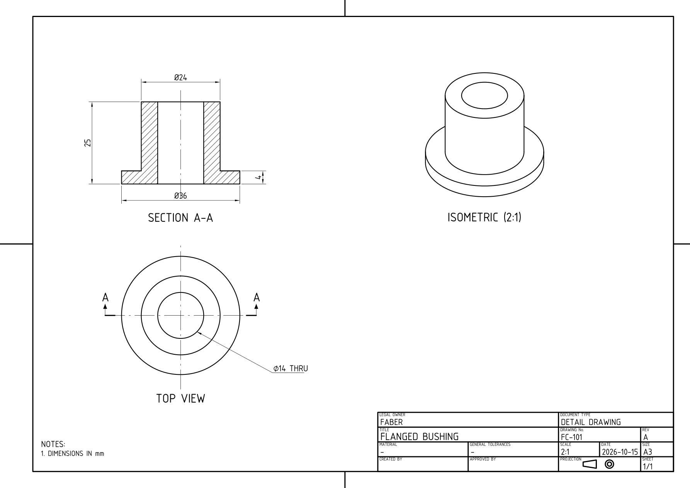
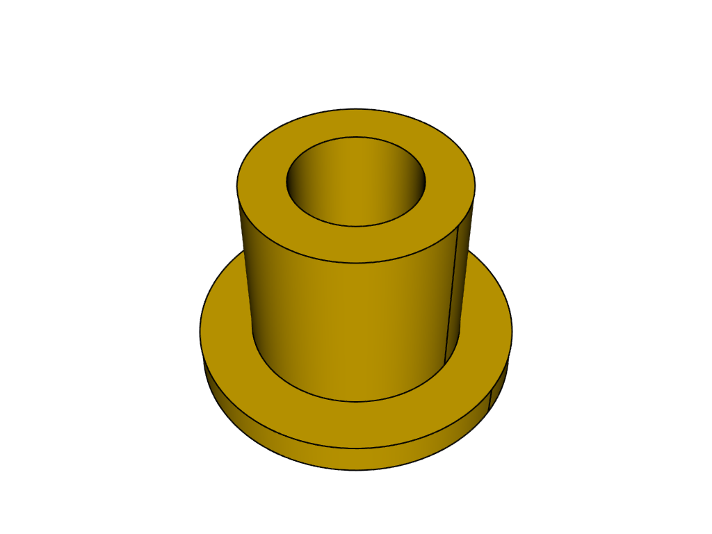

# AI Engineer: the challenge

This document is everything you need to know. No prior knowledge of Faber or CAD is assumed. Practical questions (access, budget, setup): jules@faber.ai.

## About Faber

Faber builds artificial engineers: AI agents that carry out mechanical engineering tasks, so engineers can spend their time on design and judgment. CAD (computer-aided design) is how engineers create precise 3D models of parts. Python libraries such as CadQuery and build123d let an agent build these models with code. STEP is the standard file format for exchanging them between CAD tools.

Most of our work starts the same way: a manufacturer has a problem, we turn it into an agent they can rely on, and what we learn goes back into the product. This challenge is one of those problems.

## The client

Our client is a precision machining subcontractor of about forty people. Their head of methods wrote to us:

> Most of the parts we are asked to make arrive as a 2D drawing, not as a 3D model: spare parts for old machines, customers who only send a PDF, sometimes a scan of a paper drawing. Before our CAM programmers can program a machine, someone has to remodel the part in 3D by hand. It takes one to three hours a part, it is not anyone's favourite job, and a mistake in the model becomes a mistake on the machine.
>
> We would like a tool our methods team can use themselves: they drop in a drawing and get back a 3D part they can open in their CAD software. They need to know when they can trust it and when they cannot, because checking every part as carefully as they would model it saves nothing. Several people will use it at once, often on long batches, and it must not lose their work. Model calls cost money, so we need to know what a part costs us.
>
> We are not sure what is realistic. Tell us what you can do, how well it works, and what you would do next.

There is nobody to ask. Where the need is ambiguous, decide, write down your assumption, and say how you would check it with the client.

<table><tr><th width="50%">What the client sends: an engineering drawing</th><th width="50%">What they need back: the part in 3D (reference CAD)</th></tr><tr><td></td><td></td></tr></table>

## What you deliver

Build a drawing-to-3D product that answers the client's need:

1. **An agentic loop that turns a drawing into a STEP part.** Design the harness around the model; prompts, tools, execution, and feedback are yours to choose.
2. **An evaluation of your harness.** Show what you tried, what worked, what did not, and the evidence behind your conclusions.
3. **A functional product anyone can use.** The client is neither a developer nor a computer expert: they must be able to submit drawings, run multiple jobs in parallel, inspect results, and retrieve STEP files through the UI without technical help.

Include a short write-up of your choices and findings, with an answer to the client: what they can trust, the cost and time per part, and what you recommend next.

A local product is enough; cloud deployment is not expected. Keep the scope small, but deliver a working workflow we can use on new drawings.

## What we provide

- `solve.py`: a minimal starter that calls a model once, runs its CadQuery script, and exports STEP and PNG. It has no agent loop, evaluation, or UI. The [README](README.md) explains how to run it; change or replace any part of it.
- `cases/`: 32 engineering drawings with reference STEP parts: eight per tier in tiers 1–3, plus 8 CADGenBench cases in tier 4. Use every sheet of each PDF. We keep three additional drawings aside for review, one per tier in tiers 1–3.

Tier 4 uses public submission STEPs with official volume IoU above 0.99 against CADGenBench's private ground truth. These are approximate peer references.

## Practical

- **Budget and models.** We provide an OpenRouter key with $30 total credit for development and final runs. We recommend `openai/gpt-6-luna` for this small budget; other models through OpenRouter are allowed.
- **Tools.** Prefer Python CAD libraries such as CadQuery or build123d; neither is required. Your solution must run on our Linux machines from your setup instructions, without proprietary CAD software such as SolidWorks. AI coding assistants are welcome.
- **Runtime.** Network access at runtime is limited to OpenRouter.
- **What to hand in.** Use this GitHub template and keep your submission private. Include instructions to run your agent on one drawing and on a concurrent batch, reproduce your evaluation, and inspect the saved traces. Include your technical write-up and its answer to the client. Send jules@faber.ai a link with access granted or an archive.
- **The review.** One hour with the team. We use your product on a selection of the unseen drawings, from submission to rendered results and STEP files, and check concurrent execution, including a failed job. We run your evaluation, inspect a success and a failure through their traces, discuss an experiment that did not work, and hear your answer to the client.

## What we look at

Whether you can deliver a functional product, make its agent more reliable, and demonstrate the effect of your choices. We look at the complete user workflow, CAD quality, the harness behind it, the quality of your experiments and evaluation, isolation between concurrent runs, and the judgment in your answer to the client. Understanding and explaining what worked and what did not matters more than a high score alone. A small, working product whose limits you understand is more useful than unsupported claims. Show where it breaks and explain why.

We are also interested in the tools you built or used to develop this product and agent, and how they helped you experiment, debug, and evaluate your work.
